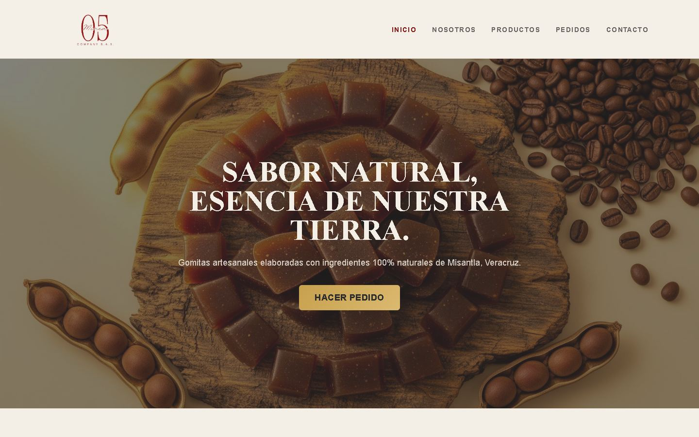
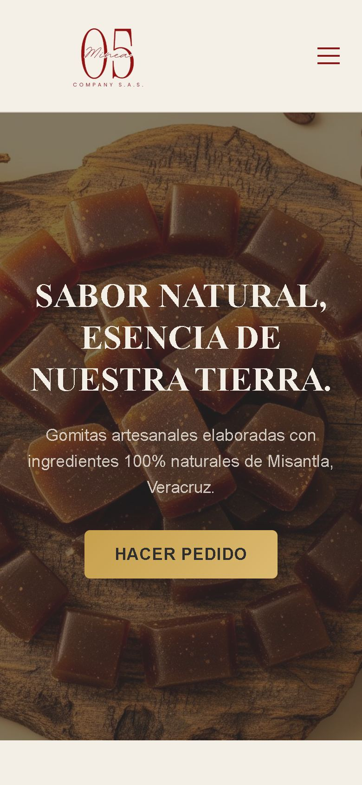
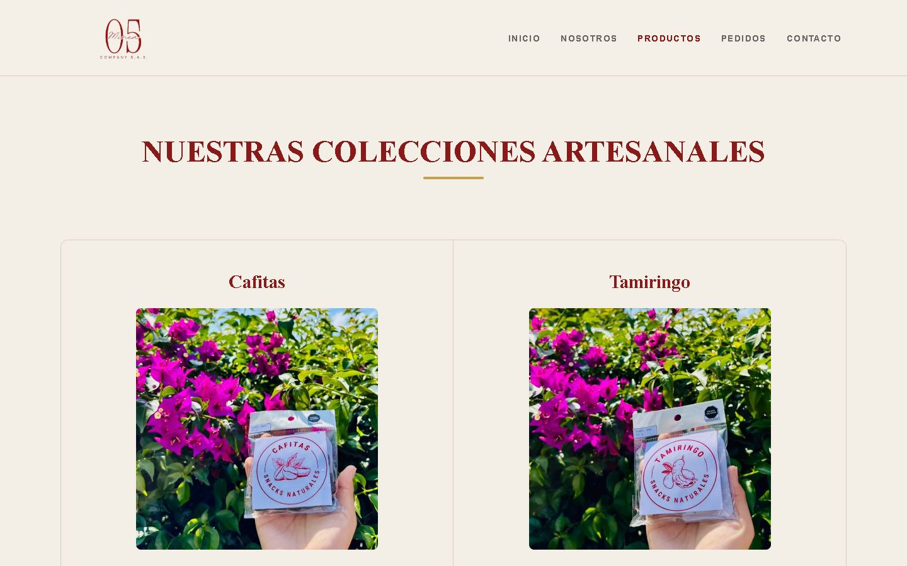

<div align="center">

# Minea Company

**Tienda en línea para gomitas artesanales de tamarindo y chile.**

[**Ver sitio**](https://minea05-company.vercel.app) · Proyecto freelance





</div>

Sitio para un emprendimiento local de dulces artesanales: presenta la marca y sus productos, y permite **armar un pedido que se envía por WhatsApp**, sin necesidad de pasarela de pago.

> **El negocio ya no opera.** Yo alojaba el sitio en Vercel; el código se publica con permiso de los dueños y los datos de contacto se reemplazaron por ejemplos.

## Funciones

- **Inicio, Nosotros y Productos:** identidad de marca, historia y colecciones con fotos.
- **Pedidos:** el cliente elige productos y cantidades, y se genera un mensaje de WhatsApp con el resumen.
- **Contacto:** mapa y formas de contacto.
- Diseño adaptable a celular y computadora, con navegación entre páginas sin recargar (React Router).

## Capturas



## Tecnología

**React 18 · TypeScript · Vite · Tailwind CSS · shadcn/ui · React Router · Vercel**

<details>
<summary><b>Cómo correrlo</b></summary>

```bash
git clone https://github.com/ZeroFuann-FS/minea-company.git
cd minea-company && npm install
npm run dev
```
</details>

---

© 2026 ZeroFuann · Código publicado como portafolio. La marca Minea pertenece a sus dueños. Ver [LICENSE](LICENSE).
